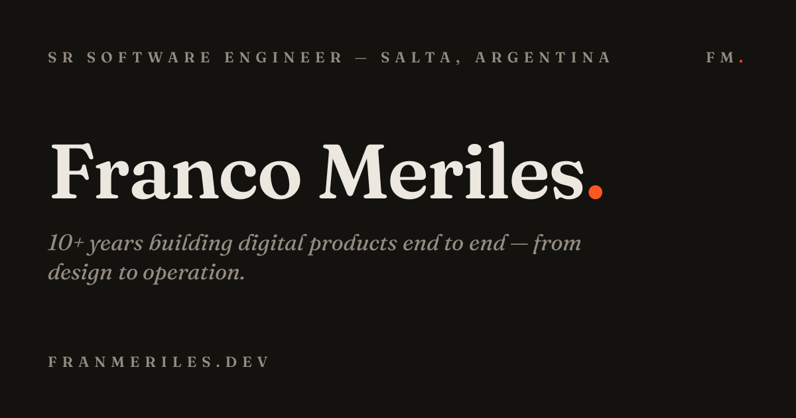

# Franco Meriles

**Sr Software Engineer** · Salta, Argentina

10+ years building digital products end to end — frontend with React and TypeScript, serverless backend with Node.js and AWS. Beyond the code: metrics-driven planning and prioritization, architecture decisions, code reviews, mentoring and product coordination — with end-to-end ownership. Currently building with GenAI tooling (Claude Code, Codex, MCP & RAGs, n8n).

**[franmeriles.dev](https://franmeriles.dev)** · [LinkedIn](https://www.linkedin.com/in/francomeriles) · [Medium](https://medium.com/@franmeriles)

## Experience

- **Mercado Libre** — Sr Software Engineer _(2020 — present)_ — Shipping / FOS: shipment management across MELI facilities in LATAM
- **Naranja X** — SSR Node.js & DX Developer _(2019 — 2020)_ — Golden API: standards and tooling for Node.js APIs, serverless on AWS
- **25Watts · Grupo Max · Punto Dos** — Front End & UI/UX _(2015 — 2019)_

## Community

- [Creando aplicaciones Serverless con LaconiaJS](https://www.youtube.com/watch?v=eaznD5CVgyo) — talk at BeerJS Córdoba, 2020
- Mentor, Full Stack Web Development — Mundos E / Universidad Nacional de Córdoba, 2020–2021

## Stack

`React` `TypeScript` `Next.js` `Node.js` `Express` `AWS Lambda` `DynamoDB` `Serverless Framework` `DDD` `Event-Driven` `Tailwind` `GenAI`

---

2nd place — Google Mobile Speed Hackathon, Buenos Aires 2017 · Speed Index 4300 ms
